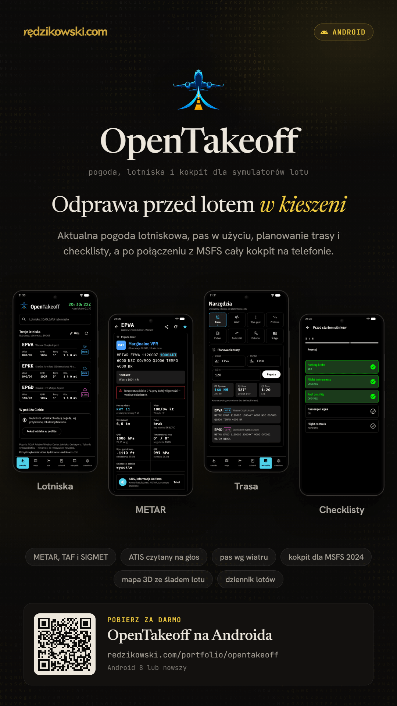

# OpenTakeoff

<!-- posters:start -->
<p align="center">
  
</p>

<p align="center"><a href="https://redzikowski.com/portfolio/opentakeoff">redzikowski.com/portfolio/opentakeoff</a></p>
<!-- posters:end -->

**Projekt i wykonanie: [redzikowski.com](https://redzikowski.com)**

[Polski](#polski) · [English](#english)

---

## Polski

Aplikacja na Androida dla wirtualnych pilotów (MSFS, X-Plane, VATSIM, IVAO). Pogoda, dane lotnisk, plan lotu i kokpit na telefonie. Korzysta wyłącznie z darmowych, otwartych źródeł danych: nie wymaga kont ani kluczy API i nie ma reklam. Interfejs jest po polsku, angielsku i hiszpańsku (zgodnie z językiem systemu albo do wyboru w ustawieniach).

Do sterowania samolotem i danych z symulatora służy **OpenTakeoff na Windows** (dawniej OpenTakeoff Link), który łączy telefon z MSFS 2024 albo X-Plane 11/12 w sieci lokalnej (X-Plane bez wtyczek, przez UDP 49000). Można go uruchomić także na drugim komputerze bez symulatora (źródło „Inny PC”): pobiera wtedy dane lotu przez sieć od OpenTakeoff na komputerze z symulatorem i przekazuje je dalej własnym telefonom. Na komputerze ma też własne funkcje: przyrządy w stylu kabiny (PFD, ND, zegary, ECAM/EICAS), mapę nawigacyjną z radialami, różami VOR i mapami lotnisk z OpenStreetMap (drogi kołowania z nazwami, tryb i trasa kołowania; każdą mapę w programie można pochylić i obrócić), dziennik lotów synchronizowany z telefonem, statystyki i briefing lotnisk, a także kartę lądowania na ekranie symulatora, pasek do transmisji (stream), okno przyrządów zawsze na wierzchu, strony paska i karty lądowania dla OBS, analizę lądowania (ślad na tle pasa, ścieżka 3°, wykresy ostatnich 30 s), import planu z SimBrief, zrzuty ekranu z miejscem samolotu na mapie i przypięte do lotów, eksport całego dziennika do Google Earth, radar opadów i METAR-y na mapie, osiągnięcia z wyzwaniami tygodnia, odtwarzanie lotu na mapie oraz checklisty dobierane do samolotu (11 zestawów: Airbus A320/A330, Boeing 737, 777/787 i 717, King Air, Caravan, C152, C172S, PA-28, SR22, DA40 NG), odhaczane ręcznie albo przez symulator, z możliwością dodawania własnych ([docs/checklists.md](docs/checklists.md)). Do tego OFP SimBrief w formie graficznej (wagi wobec limitów, paliwo, profil z wiatrem i temperaturą, navlog, METAR/TAF, prędkości TLR), kalkulatory startu i lądowania, planowanie paliwa i briefing do PDF, przyrządy w osobnych oknach na drugi monitor oraz skróty klawiaturowe (F1). Interfejs po polsku, angielsku i hiszpańsku. Instrukcja: [docs/link-setup.md](docs/link-setup.md).

### Funkcje

**Ekran główny**
- „W pobliżu”: lotniska najbliżej samolotu, gdy symulator jest połączony, a bez niego najbliżej telefonu; z bieżącą pogodą.

**Briefing lotniska**
- pogoda teraz i interaktywny METAR (dotknięcie grupy pokazuje jej znaczenie);
- wcześniejsze depesze z godziną i kategorią lotu w jednej linii;
- TAF w okresach z kategorią lotu, SIGMET i PIREP, wiatr na wysokościach;
- pasy ze składowymi wiatru, częstotliwości i ILS, okolica;
- ATIS czytany na głos z bieżącego METAR-u;
- charty FAA dla lotnisk w USA z przeglądarką PDF.

**Mapa**
- lotniska w kolorach kategorii lotu, obszary SIGMET, aktywna trasa z procedurami;
- **widok 3D**: pochylenie i obrót mapy, a przy śledzeniu kamera patrzy w kierunku lotu;
- **ślad lotu z wysokością**: linia zmienia kolor wraz z wysokością, na śladzie są etykiety wysokości (stopy albo FL), a w 3D ślad to cienka linia zawieszona na wysokości lotu (przewyższonej 3×, żeby profil był czytelny), z samolotem na jej końcu;
- bieżąca wysokość przy symbolu samolotu, budynki 3D przy dużym przybliżeniu;
- przyciski mapy w jednej grupie przy prawej krawędzi (warstwy, śledzenie samolotu, przybliżenie) i kompas pod paskiem stanu; w menu warstw METAR, SIGMET, bieżący odcinek planu lotu z GPS symulatora oraz lotniska, VOR, NDB i punkty z bazy MSFS wokół samolotu;
- każdy zapisany lot można otworzyć na mapie 3D z dziennika lotów;
- **mapy lotnisk** po przybliżeniu: płyty, pasy i drogi kołowania z oznaczeniami („A”, „B2”), a dla lotniska pobranego z OpenStreetMap także terminale, hangary, stanowiska, bramki i miejsca oczekiwania przed pasem (pobierane raz, potem działają bez sieci);
- **tryb kołowania**: na ziemi poniżej 40 kt mapa sama przybliża się do lotniska i obraca zgodnie z kursem, a pasek na górze pokazuje drogę pod samolotem, najbliższe skrzyżowanie i pas przed samolotem;
- **trasa kołowania**: wpisz „A B2 H 27”, sam pas albo stanowisko (albo dotknij stanowiska na mapie) – trasa podświetla się na mapie z długością, czasem i ostrzeżeniem „HOLD SHORT” przed każdym przecinanym pasem;
- pierścienie 5, 10 i 20 NM wokół samolotu.

**Plan lotu** — prosto z symulatora: następny punkt, odległość, czasy i bieżący odcinek z GPS MSFS (bez planowania tras w aplikacji).

**Kokpit (z OpenTakeoff Link)**
- **jeden widok do latania**: PFD, ND, dźwignie mocy i pływający przycisk sterowania na ekranie naraz, bez przewijania (telefon pionowo: PFD nad ND, dźwignie z boku; poziomo: wszystko w rzędzie; tablet: obok stała kolumna albo pod spodem stały panel autopilota, radia itd.). Tryb i zasięg ND oraz warstwy to małe przyciski EFIS na samym wyświetlaczu, a przycisk rozglądania się jest w nagłówku. Autopilot, radio, systemy, silniki i postęp otwierają się z paska ikon w miejscu ND, więc PFD i dźwignie zostają na widoku;
- **PFD**: horyzont, taśmy prędkości i wysokości z nastawami, wskaźnik prędkości pionowej ze skalą 1–2–6 tys. ft/min, wektor toru lotu (znos i kąt toru), trend prędkości na 10 s, Mach, QNH, wysokość nad terenem z pasem ziemi, znacznik toru, wiatr i tryby autopilota (FMA);
- **MFD/ND** w trybach ARC i ROSE: trasa, nastawa kursu, następny punkt z odległością, namiarem i czasem, a z bazy MSFS lotniska, VOR (z częstotliwością), NDB i punkty trasy wokół samolotu (warstwy do włączenia); pod mapą profil pionowy (VSD) z wysokością wybraną i torem przy bieżącej prędkości pionowej;
- **silniki**: wyświetlacz EICAS/ECAM (N1 albo obroty, EGT, przepływ i zapas paliwa) oraz pulpit dźwigni przeciąganych palcem — moc, a w tłokowych i turbośmigłowych także mieszanka i śmigło; odrzutowce mają zapadki IDLE/CL/FLX/TOGA, TO/GA i odwracacz ciągu;
- **kamera MSFS**: przycisk kabina ↔ widok zewnętrzny, a obok rozglądanie się — przytrzymaj i przechylaj telefon albo przesuwaj palec; kamera obraca się w bieżącym widoku (okno MSFS musi być aktywne), puszczenie wraca na wprost, a krótkie dotknięcie wyjaśnia, jak to działa;
- **autopilot z pokrętłami** jak w awionice: podwójne pokrętło (zewnętrzny pierścień zmienia o duży krok, środek o mały), przyciski −/+ z powtarzaniem i okienko, w które można wpisać wartość. Pod każdą nastawą są jej przyciski trybów. Panel wygląda jak u producenta — Airbus FCU (bursztynowe okienka, zielone kreski lampek), Boeing MCP (kwadratowe klawisze z lampką), Garmin (cyjanowe wartości), GA w stylu KAP140 — i dopasowuje się do motywu aplikacji. Profil wybiera się automatycznie albo ręcznie;
- radio (COM, NAV, transponder) i systemy (podwozie, klapy, spoilery, trym, światła).

**Sterowanie samolotem**
- **żyroskop** (domyślnie): trzymasz telefon jak wolant; steruje tylko podczas przytrzymania, a puszczenie od razu oddaje stery;
- drążek pod kciukiem albo fizyczny kontroler lub joystick (Bluetooth, USB-C);
- **pływający przycisk sterowania**: widoczny na każdej zakładce, więc można przeglądać briefing czy mapę i mieć stery pod ręką. Przytrzymaj go i przechylaj telefon (żyroskop) albo przesuwaj kciuk (drążek). Da się go przesunąć za uchwyt. Wariant **z trymem**: przy żyroskopie trymujesz przeciągnięciem palca na przycisku (w dół — nos w górę, w górę — nos w dół), przy drążku trym ma osobne przyciski.

**Dziennik lotów**
- zapis można zakończyć ręcznie wskaźnikiem nagrywania w nagłówku kokpitu (kolejny zacznie się po wylądowaniu albo po wznowieniu);
- osobny ekran z podsumowaniem, filtrem i lotami pogrupowanymi po miesiącach; przy każdym trasa, czas, dystans, wysokość, ocena lądowania i miniatura profilu;
- automatyczny zapis każdego lotu: pozycja, wysokość, prędkość względem ziemi i przyrządowa, prędkość pionowa, kurs; **restart lotu w symulatorze** (skok pozycji albo inny samolot) zamyka bieżący wpis i zaczyna nowy; lot zapisuje się także, gdy symulator przestanie wysyłać dane albo system zamknie aplikację w trakcie lotu;
- częstotliwość zapisu do wyboru w ustawieniach: 4×, 2× lub 1× na sekundę, co 2 s albo co 5 s;
- kompaktowe archiwum: tor jest zapisywany jako różnice między punktami i pakowany gzipem, więc zajmuje ułamek zwykłego JSON-a;
- eksport i import całej historii w jednym pliku `.oab` (kopia zapasowa, przeniesienie na inny telefon) oraz eksport pojedynczego lotu do GPX;
- wykresy wysokości, prędkości i prędkości pionowej oraz ocena lądowania (prędkość pionowa, przeciążenie, położenie względem osi i progu pasa, odbicia).

**Pozostałe**
- narzędzia: kalkulator wiatru, wysokość gęstościowa, zniżanie, paliwo, jednostki, dekoder METAR i TAF, ściąga radiowa;
- motywy AMOLED (czysta czerń), grafitowy i jasny; układy na telefon pionowo i poziomo oraz tablet;
- dotknięcie logo wraca na ekran główny;
- automatyczne aktualizacje z GitHuba.

### Źródła danych

| Dane | Źródło | Licencja |
|---|---|---|
| METAR, TAF, SIGMET, PIREP | [aviationweather.gov Data API](https://aviationweather.gov/data/api/) | domena publiczna (NOAA) |
| Lotniska, pasy, częstotliwości, pomoce nawigacyjne | [OurAirports](https://ourairports.com/data/) | domena publiczna |
| Mapy lotnisk (drogi kołowania, stanowiska) | © współtwórcy [OpenStreetMap](https://www.openstreetmap.org/copyright) przez [Overpass API](https://overpass-api.de/) | ODbL |
| Wiatr i temperatura na wysokościach | [Open-Meteo](https://open-meteo.com/) | CC BY 4.0 |
| Podkład mapy i budynki | [OpenFreeMap](https://openfreemap.org/) / OpenStreetMap | ODbL |
| Charty (USA) | [FAA d-TPP](https://www.faa.gov/air_traffic/flight_info/aeronav/digital_products/dtpp/) | domena publiczna |
| Procedury, ILS, lotniska i pomoce na ND, stan lotu | baza i SimConnect Twojego MSFS przez OpenTakeoff Link | — |

Baza OurAirports pobiera się raz przy pierwszym uruchomieniu i odświeża co 30 dni. Historia lotów i trasy są przechowywane tylko na telefonie.

> Tylko do symulacji lotów. Nie używaj do rzeczywistej nawigacji.

### Budowanie

Kotlin, Jetpack Compose i Material 3, minSdk 26. OpenTakeoff na Windows: Rust i Slint (folder `desktop/`).

Lokalnie skrypt `tools/build-local.ps1` buduje APK i Link oraz uruchamia testy:

```bash
powershell -ExecutionPolicy Bypass -File tools/build-local.ps1
```

### Wydania

Każdy wypchnięty tag `vX.Y.Z` uruchamia [workflow](.github/workflows/release.yml), który buduje APK i instalator `OpenTakeoff-Setup-X.Y.Z.exe`. Wydanie powstaje po wypchnięciu tagu `vX.Y.Z` (np. `git tag v2.0.1 && git push origin v2.0.1`): workflow buduje obie aplikacje w wersji `X.Y.Z` i publikuje je w wydaniu o tej nazwie. Człony `Y` i `Z` muszą być mniejsze niż 100.

Bez sekretów APK jest podpisane kluczem debug. Żeby aktualizacje instalowały się na stałym kluczu, dodaj sekrety repozytorium: `SIGNING_KEYSTORE_BASE64`, `SIGNING_STORE_PASSWORD`, `SIGNING_KEY_ALIAS`, `SIGNING_KEY_PASSWORD`.

---

## English

An Android app for flight-sim pilots (MSFS, X-Plane, VATSIM, IVAO): weather, airport data, flight planning and a cockpit on your phone. It uses free and open data sources only, with no accounts, API keys or ads. The interface is in English, Polish and Spanish (follows the system language or can be set in Settings).

To fly the aircraft and read live data from the simulator, run **OpenTakeoff for Windows** (formerly OpenTakeoff Link), which connects the phone to MSFS 2024 or X-Plane 11/12 over your local network (X-Plane without plugins, via UDP 49000). It can also run on a second computer without the simulator ("Other PC" source): it then gets flight data over the network from OpenTakeoff on the simulator PC and passes it on to its own phones. On the PC it also offers cockpit-style instruments (PFD, ND, gauges, ECAM/EICAS), a navigation map with VOR radials, compass roses and OpenStreetMap airport maps (labelled taxiways, taxi mode and taxi routes; every map in the program can be tilted and rotated), a logbook synced with the phone, statistics and airport briefings, plus a landing card on the simulator screen, a streaming bar, an always-on-top instrument window, OBS browser-source pages for the bar and the landing card, landing analysis (track over the runway, 3° path, charts of the last 30 s), SimBrief flight plan import, screenshots pinned to the aircraft position and to flights, export of the whole logbook to Google Earth, precipitation radar and METARs on the map, achievements with weekly challenges, flight replay on the map, and aircraft checklists (11 sets: Airbus A320/A330, Boeing 737, 777/787 and 717, King Air, Caravan, C152, C172S, PA-28, SR22, DA40 NG) ticked off by hand or by the simulator, with support for your own checklist files ([docs/checklists.md](docs/checklists.md), in Polish). On top of that: a graphical SimBrief OFP view (weights against limits, fuel, profile with winds and temperatures, navlog, METAR/TAF, TLR speeds), takeoff and landing calculators, fuel planning and a PDF briefing, instruments in separate windows for a second monitor, and keyboard shortcuts (F1); hovering over an aviation abbreviation explains it. The interface is available in Polish, English and Spanish. Setup: [docs/link-setup.md](docs/link-setup.md) (in Polish).

### Features

**Home screen**
- “Nearby”: the airports closest to the aircraft while the simulator is connected, otherwise closest to the phone, with current weather.

**Airport briefing**
- current weather and an interactive METAR (tap a group to see what it means);
- earlier reports with time and flight category on one line;
- TAF split into periods with flight category, SIGMETs and PIREPs, winds aloft;
- runways with wind components, frequencies and ILS, nearby airports;
- ATIS read aloud from the latest METAR;
- FAA charts for US airports with a PDF viewer.

**Map**
- airports coloured by flight category, SIGMET areas, the active route with procedures;
- **3D view**: tilt and rotate the map; while following the aircraft the camera looks along the flight path;
- **flight track with altitude**: the line changes colour with altitude and carries altitude labels (feet or FL). In 3D the track is a thin line hanging at flight altitude (exaggerated 3× so the profile is readable) with the aircraft at its end;
- current altitude next to the aircraft symbol, 3D buildings when zoomed in;
- map buttons in one group along the right edge (layers, follow aircraft, zoom) and the compass below the status bar; the layers menu has METAR, SIGMET, the current flight-plan leg from the simulator GPS, and airports, VORs, NDBs and waypoints from the MSFS database around the aircraft;
- any saved flight can be opened on the 3D map from the logbook;
- **airport maps** when zoomed in: aprons, runways and taxiways with their designators ("A", "B2"); for an airport downloaded from OpenStreetMap also terminals, hangars, stands, gates and runway holding points (downloaded once, then they work offline);
- **taxi mode**: on the ground below 40 kt the map zooms in to the airport and turns with the heading, and a bar at the top shows the taxiway under the aircraft, the next intersection and the runway ahead;
- **taxi route**: type "A B2 H 27", just a runway or a stand (or tap a stand on the map) – the route is highlighted with its length, time and a "HOLD SHORT" warning before every runway it crosses;
- 5, 10 and 20 NM range rings around the aircraft.

**Flight plan** — straight from the simulator: next waypoint, distance, times and the current leg from the MSFS GPS (no route planning in the app).

**Cockpit (with OpenTakeoff Link)**
- **one view for flying**: PFD, ND, thrust levers and the floating control button on screen at once, without scrolling (phone in portrait: PFD above ND, levers at the side; landscape: all in one row; tablet: a fixed column or a fixed panel below for the autopilot, radios and more). ND mode, range and layers are small EFIS buttons on the display itself, and the look-around button sits in the header. Autopilot, radios, systems, engines and progress open from an icon bar in place of the ND, so the PFD and levers stay in view;
- **PFD**: horizon, speed and altitude tapes with selected values, a vertical speed indicator with a 1–2–6 thousand ft/min scale, flight path vector (drift and flight path angle), 10-second speed trend, Mach, QNH, height above terrain with a ground band, track marker, wind and autopilot modes (FMA);
- **MFD/ND** in ARC and ROSE modes: route, selected heading, next waypoint with distance, bearing and time, and from the MSFS database the airports, VORs (with frequency), NDBs and waypoints around the aircraft (layers can be toggled); below it a vertical situation display (VSD) with the selected altitude and the path at the current vertical speed;
- **engines**: an EICAS/ECAM display (N1 or RPM, EGT, fuel flow and fuel on board) and a throttle quadrant you drag with your finger — thrust, plus mixture and propeller on piston and turboprop aircraft; jets get IDLE/CL/FLX/TOGA detents, TO/GA and reverse thrust;
- **MSFS camera**: a cockpit ↔ outside view button, and next to it look around — hold and tilt the phone or slide your finger; the camera turns in the current view (the MSFS window must be active), let go to return to straight ahead, tap it for a short explanation;
- **autopilot with knobs** like real avionics: a dual knob (the outer ring moves in big steps, the centre in small ones), −/+ buttons that repeat when held, and a window you can tap to type a value. Each setting has its mode buttons right below it. The panel looks like the manufacturer's — Airbus FCU (amber windows, green lamp bars), Boeing MCP (square keys with a lamp), Garmin (cyan values), GA in KAP140 style — and adapts to the app theme. The profile is picked automatically or by hand;
- radios (COM, NAV, transponder) and systems (gear, flaps, spoilers, trim, lights).

**Flying the aircraft**
- **gyro** (default): hold the phone like a yoke; it only flies while you hold the pad, and letting go hands control back at once;
- an on-screen thumb stick, or a physical controller or joystick (Bluetooth, USB-C);
- **floating control button**: shown on every tab, so you can read the briefing or the map with the controls under your thumb. Hold it and tilt the phone (gyro) or move your thumb (stick). Drag it by the handle to move it. The **with trim** variant: with the gyro you trim by dragging your finger on the button (down — nose up, up — nose down); with the stick, trim has its own buttons.

**Logbook**
- recording can be stopped by hand from the recording indicator in the cockpit header (the next one starts after landing or when you resume it);
- its own screen with a summary, a filter and flights grouped by month; each shows the route, time, distance, altitude, landing score and a profile thumbnail;
- every flight is recorded automatically: position, altitude, ground and indicated speed, vertical speed, heading; **restarting the flight in the simulator** (a position jump or another aircraft) closes the current entry and starts a new one; a flight is also saved when the simulator stops sending data or the system closes the app mid-flight;
- recording rate is set in Settings: 4, 2 or 1 times per second, every 2 s or every 5 s;
- compact archive: the track is stored as differences between points and gzip-compressed, a fraction of the size of plain JSON;
- export and import of the whole history as a single `.oab` file (backup or moving to another phone), plus GPX export of a single flight;
- altitude, speed and vertical speed charts, and a landing score (vertical speed, g-force, position relative to the runway centreline and threshold, bounces).

**Also**
- tools: wind calculator, density altitude, descent, fuel, unit converter, METAR and TAF decoder, radio phraseology;
- AMOLED (true black), graphite and bright themes; layouts for phones in portrait and landscape and for tablets;
- tapping the logo takes you back to the home screen;
- automatic updates from GitHub.

### Data sources

| Data | Source | Licence |
|---|---|---|
| METAR, TAF, SIGMET, PIREP | [aviationweather.gov Data API](https://aviationweather.gov/data/api/) | public domain (NOAA) |
| Airports, runways, frequencies, navaids | [OurAirports](https://ourairports.com/data/) | public domain |
| Airport maps (taxiways, stands) | © [OpenStreetMap](https://www.openstreetmap.org/copyright) contributors via [Overpass API](https://overpass-api.de/) | ODbL |
| Winds and temperatures aloft | [Open-Meteo](https://open-meteo.com/) | CC BY 4.0 |
| Base map and buildings | [OpenFreeMap](https://openfreemap.org/) / OpenStreetMap | ODbL |
| Charts (USA) | [FAA d-TPP](https://www.faa.gov/air_traffic/flight_info/aeronav/digital_products/dtpp/) | public domain |
| Procedures, ILS, airports and navaids on the ND, live flight data | your MSFS database and SimConnect via OpenTakeoff Link | — |

The OurAirports database downloads once on first launch and refreshes every 30 days. Flight history and routes stay on the phone.

> For flight simulation only. Do not use for real-world navigation.

### Building

Kotlin, Jetpack Compose and Material 3, minSdk 26. OpenTakeoff for Windows: Rust and Slint (in `desktop/`).

Locally, `tools/build-local.ps1` builds the APK and Link and runs the tests:

```bash
powershell -ExecutionPolicy Bypass -File tools/build-local.ps1
```

### Releases

Every push to `main` runs the [workflow](.github/workflows/release.yml), which builds the APK and the `OpenTakeoff-Setup-X.Y.Z.exe` installer. A release is created by pushing a `vX.Y.Z` tag (e.g. `git tag v2.0.1 && git push origin v2.0.1`): the workflow builds both apps as version `X.Y.Z` and publishes them under that release. `Y` and `Z` must be below 100.

Without secrets the APK is signed with the debug key. To keep updates on a fixed key, add these repository secrets: `SIGNING_KEYSTORE_BASE64`, `SIGNING_STORE_PASSWORD`, `SIGNING_KEY_ALIAS`, `SIGNING_KEY_PASSWORD`.

---

<a href="https://buycoffee.to/adamredzikowski" target="_blank"></a>
